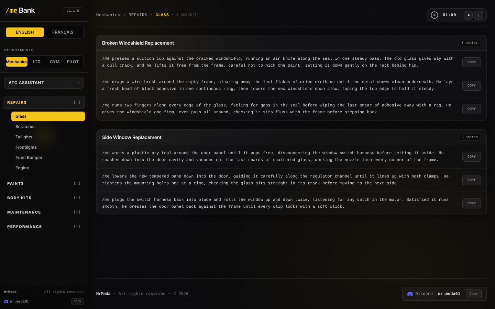

# /me Bank


**Live:** [mebank-blush.vercel.app](https://mebank-blush.vercel.app)

`/me Bank` is a personal library of `/me` emotes for text-based roleplay (FiveM / GTA World), built with **Next.js**, **Tailwind CSS** and **Framer Motion**. Emotes are grouped by department (Mechanics, LTD, Gym, Pilot), category and scene, in English and French, and each one is copied to the clipboard in one click.



## ✨ Features

- **Emote library** by department → category → sub-category → scene, in English and French
- **One-click copy** with visual confirmation
- **Countdown timer** (1 minute by default) to pace a scene
- **ATC Assistant** (`/atc`): an early version of the pilot radio-call tool, using the GTA World radar and SAAA data through the `/api/radar` and `/api/saaa` routes. It later became its own project, [GTA W Flight Instruments](https://github.com/medazero01-art/gta-w-flight-instruments).

---

## 🎨 Visual Identity & Aesthetic

The application features a modern **glassmorphism** design system with rich depth and details:
- **Base Theme:** Ultra-dark theme (`#0A0A0C`) with layered frosted glass panels (`bg-white/5` and `bg-white/8`, `backdrop-blur-xl`, `border-white/10`).
- **Tactility:** Subtle SVG fractal noise overlay to create a paper-like grain texture.
- **Selective Accents:** Amber/yellow (`#F5C518`) used sparingly for highlights, copy success states, active categories, and active tabs.
- **Ambient Depth:** Slow, heavily-blurred background radial gradient glows reflecting the accent color.

---

## ⚡ Motion & Transitions

All interaction states are animated using **Framer Motion** for a fluid, tactile desktop application experience:
- **Department & Language Switchers:** Segmented pills slide smoothly between active options using Framer Motion `layoutId` layout animations.
- **Sidebar Expand/Collapse:** Smooth height animations on category lists with staggered fade-in animations on subcategories.
- **Main Section Transitions:** Layout changes trigger a 220ms crossfade and subtle vertical slide to keep interactions responsive.
- **Scene Card Entrances:** Staggered load animation on lists (40ms stagger offset) for clean page presentation.
- **Copy Feedback:** Quick scale-spring bounce animation on copy buttons morphing into a "Copied!" confirmation.
- **Accessibility:** Detects and respects system `prefers-reduced-motion` settings, falling back to simple opacity fades.

---

## 📂 Project Structure

```
├── src
│   ├── app
│   │   ├── page.js          # Emote library (Framer Motion logic & UI)
│   │   ├── atc/             # ATC Assistant page
│   │   ├── api/radar/       # Proxy + cache for the GTA World radar
│   │   ├── api/saaa/        # Proxy + cache for SAAA weather and NOTAMs
│   │   ├── globals.css      # Glassmorphism variables & noise overlay
│   │   └── layout.js
│   ├── components
│   │   ├── Timer.js         # Scene timer
│   │   └── atc/             # ATC Assistant panels
│   ├── lib/atc/             # Phraseology, airports, taxi routes, radar helpers
│   └── data.js              # Emote dataset (EN/FR)
├── tailwind.config.js
└── package.json
```

---

## 🗃️ Data Schema

Emote structures are completely dynamic and support multi-department categorization. They are defined in `src/data.js` using the following schema:

```javascript
export const RolePlay = {
  EN: {
    departmentName: {
      categoryName: {
        subcategoryName: [
          {
            title: "Scene Title",
            emotes: [
              "/me walks over to the table...",
              "/me picks up the folder..."
            ]
          }
        ]
      }
    }
  },
  FR: {
    // Equivalent localization mapping
  }
};
```

*To introduce additional departments (e.g. `LTD`, `police`), simply define their categories, subcategories, and scenes under the locale key in `src/data.js`.*

---

## 🚀 Getting Started

### 1. Install Dependencies
```bash
npm install
```

### 2. Start the Development Server
```bash
npm run dev
```
Open [http://localhost:3000](http://localhost:3000) in your browser.

### 3. Build for Production
```bash
npm run build
```
The production build is written to the `.next` directory.

---

## 👤 Author

**Ayoub Touat** · [@medazero01-art](https://github.com/medazero01-art)
